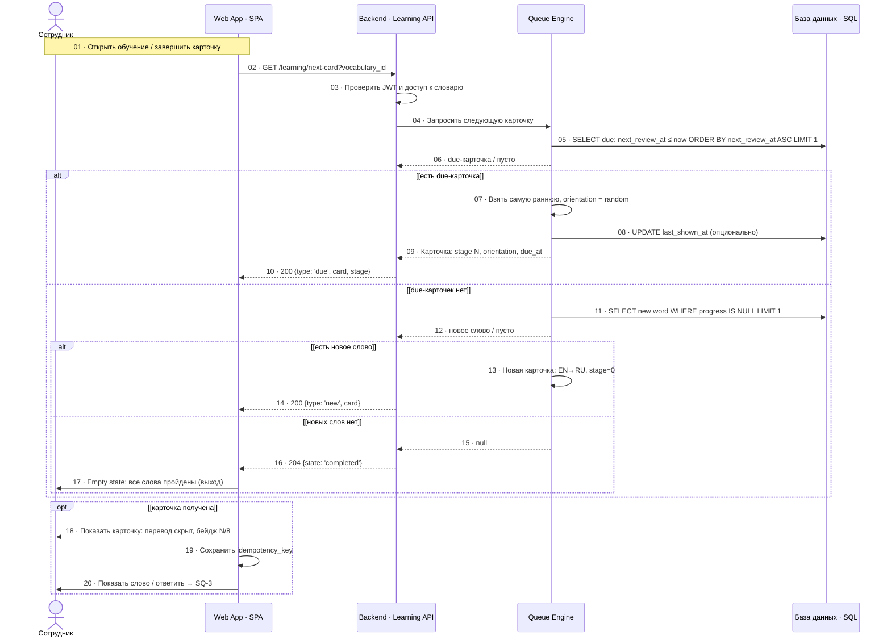

# SQ-2 · Получение следующей карточки и приоритет очереди

> Источник: `docs/sources/tbank-english-learning-uml.drawio`, страница `sq-next-card` (v1.0 · 25.10.2026).
> Сначала due-карточки в ротации — от самой ранней; новые слова — только после опустошения due-очереди.

## Диаграмма



## Приоритет очереди

1. `in_rotation` и `next_review_at ≤ now` (due-карточки).
2. `ORDER BY next_review_at ASC` (самые ранние первыми).
3. Новые слова — только если due пуста.
4. Иначе — empty state.
   Пример: `sick` due 13:40 → `feel` due 14:50 (показываем sick первым).

## Ориентация

- Новое слово — всегда EN → RU, `stage = 0`.
- Ротация — случайно EN → RU / RU → EN.
- Перевод передаётся в ответе, но скрыт до нажатия «Показать слово».

## Контракт 200

```json
{ "type": "due" | "new", "card": { "word_id": 1, "word": "sick", "transcription": "sɪk", "translation": "больной", "word_type": "Прилагательное", "orientation": "EN_RU" }, "stage": 2, "due_at": "2026-01-14T13:40:00Z" }
```

- `204` — карточек больше нет;
- `401` — истёк токен;
- `409` — доступ к словарю не подтверждён / словарь не найден.

## Почему по одной карточке

Сервер пересчитывает очередь на каждый запрос. Клиент не хранит порядок; после ответа по карточке Web снова вызывает `next-card`.

**Инварианты**: одна карточка за запрос · due раньше новых · новый тип всегда EN → RU · перевод не раскрывается автоматически · после ответа очередь пересчитывается.
