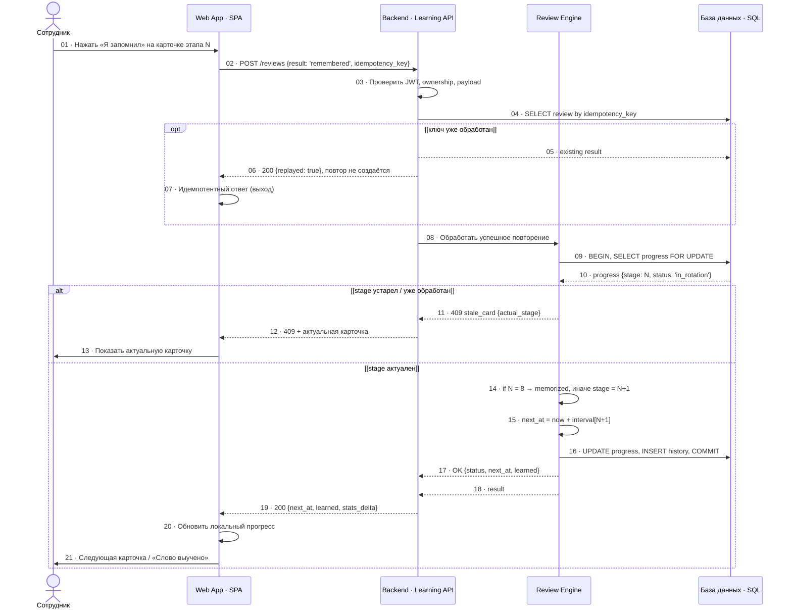

# SQ-3 · Успешное повторение в ротации

> Источник: `docs/sources/tbank-english-learning-uml.drawio`, страница `sq-review` (v1.0 · 25.10.2026).
> Ответ «Я запомнил»: идемпотентность, блокировка прогресса, следующий этап и завершение после 8-го успеха.

## Диаграмма

## Лестница повторений

| Этап | Интервал до показа |
|---|---|
| 1 | 5 минут |
| 2 | 1 час |
| 3 | 1 день |
| 4 | 1 неделя |
| 5 | 1 месяц |
| 6 | 3 месяца |
| 7 | 6 месяцев |
| 8 | 12 месяцев |

## Завершение

8-е успешное подтверждение → `status = memorized`, `next_review_at = NULL`. Слово исчезает из очереди и попадает в статистику.

## Ветка «Не запомнил»

`POST /reviews` с `result: 'not_remembered'`: слово повторяется через 5 мин и 1 ч, затем возвращается к следующему этапу. Отдельная ветка — см. WS-3, Decision D-02 (в диаграмме sq-3 не детализируется).

## Гарантии

- `Idempotency-Key` — повторная отправка не создаёт дублей (`200 {replayed: true}`).
- `SELECT ... FOR UPDATE` — блокировка строки прогресса на время транзакции.
- `409 stale_card` — ответ по устаревшему этапу не применяется.
- Аудит: INSERT history на каждое повторение.

**Лестница**: 8 успешных повторений. Интервалы 5 мин → 1 ч → 1 день → 1 нед → 1 мес → 3 мес → 6 мес → 12 мес (D-03).
