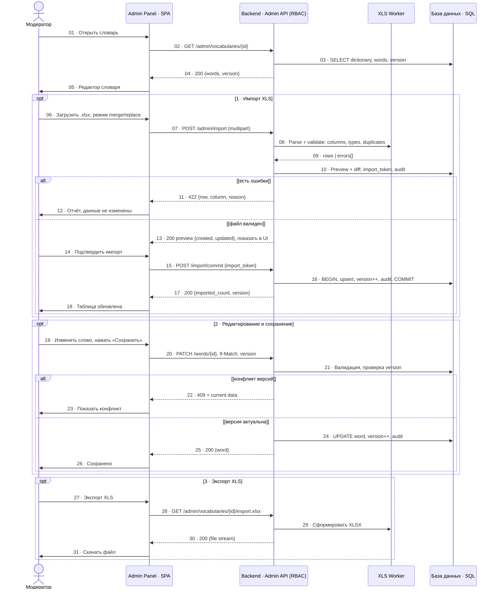

# SQ-4 · Админка: работа со словарями

> Источник: `docs/sources/tbank-english-learning-uml.drawio`, страница `sq-admin` (v1.0 · 25.10.2026).
> Импорт XLS с preview и подтверждением, ручное редактирование с optimistic locking, экспорт XLSX.
> Предусловие: модератор/администратор уже авторизован; RBAC проверяется на каждом запросе.

## Диаграмма

## Импорт

- Валидация: обязательные колонки `word`, `translation`, `transcription`, `type`; уникальность `word` в словаре.
- Поток: Preview → подтверждение → транзакция. Ошибка → 422 и полный откат, данные не меняются.
- Режимы: **merge** (дефолт) / **replace** (явный флаг подтверждения).

## Редактирование

- Optimistic locking по `version` (If-Match). `409` → показать конфликт, не перезаписывать.
- Audit log: кто / что / когда.

## Экспорт

- XLSX с колонками `word`, `translation`, `transcription`, `type`. Имя файла: `vocabulary-{id}.xlsx`. Файл собирает backend.

## Ошибки

| Код | Причина |
|---|---|
| 401 / 403 | нет сессии / нет прав |
| 413 | файл слишком большой |
| 422 | ошибки строк (row, column, reason) |
| 409 | конфликт версии |
| 500 | транзакция откатывается |

## Соседние админ-сценарии (не в этой диаграмме)

Статистика пользователей (+выгрузка XLS) и управление ролями — отдельные админ-сценарии с тем же RBAC-принципом.
