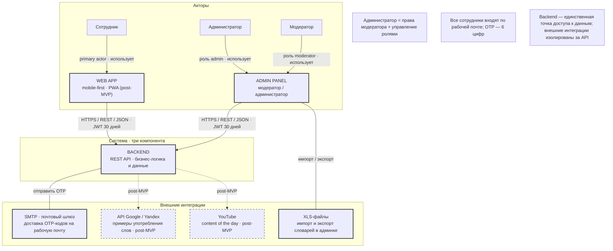

# UC-1 · Контекст системы

> Источник: `docs/sources/tbank-english-learning-uml.drawio`, страница `uc-context` (v1.0 · 25.10.2026).
> Легенда: сплошной контур = MVP, пунктир = post-MVP.

## Диаграмма

## Роли и правила

- **Сотрудник** — primary actor, работает только через Web App.
- **Модератор** — через Admin Panel: статистика и словари.
- **Администратор** = права модератора + управление привилегиями (RBAC).
- Все сотрудники входят по рабочей почте; OTP — 6 цифр.
- Backend — единственная точка доступа к данным; внешние интеграции изолированы за API.

## Use cases · Сотрудник (Web App)

| # | Use case | MVP |
|---|---|---|
| 1 | Войти по email и OTP | ✅ |
| 2 | Учить и повторять слова | ✅ |
| 3 | Выбрать словарь | ✅ |
| 4 | Смотреть статистику | ✅ |
| 5 | Сбросить прогресс | ✅ |
| 6 | Сменить тему | ✅ |
| 7 | Профиль и лидерборд | ❌ post-MVP |
| 8 | Content of the day | ❌ post-MVP |
| 9 | Пуши и диплинки | ❌ post-MVP |
| 10 | Ручное повторение | ❌ post-MVP |

## Use cases · Backend (API)

| # | Use case | MVP |
|---|---|---|
| 1 | Отправить OTP на email | ✅ |
| 2 | Проверить OTP · выдать токен | ✅ |
| 3 | Отдать словарь и очередь | ✅ |
| 4 | Сохранить прогресс и этап | ✅ |
| 5 | Отдать статистику | ✅ |
| 6 | Проверить роль и доступ (RBAC) | ✅ |
| 7 | Администрировать словари | ✅ |
| 8 | API лидерборда | ❌ post-MVP |
| 9 | API content of the day | ❌ post-MVP |

## Use cases · Админка (модератор / администратор)

| # | Use case | Кто | MVP |
|---|---|---|---|
| 1 | Войти в админку по OTP | модератор, администратор | ✅ |
| 2 | Смотреть прогресс пользователей | модератор, администратор | ✅ |
| 3 | Выгрузить статистику XLS | модератор, администратор | ✅ |
| 4 | Импортировать словарь XLS | модератор, администратор | ✅ |
| 5 | Редактировать словарь | модератор, администратор | ✅ |
| 6 | Выгрузить словарь XLS | модератор, администратор | ✅ |
| 7 | Смотреть пользователей | модератор, администратор | ✅ |
| 8 | Управлять ролями | администратор | ✅ |
| 9 | Править ФИО и фото | администратор | ❌ post-MVP |
| 10 | Content of the day | модератор, администратор | ❌ post-MVP |

Детализация обучения — в UC-2 (`uc-2-learning.md`).