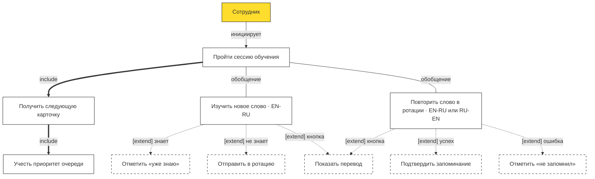

# UC-2 · Обучение: карточки и ротация

> Источник: `docs/sources/tbank-english-learning-uml.drawio`, страница `uc-learning` (v1.0 · 25.10.2026).
> Предусловие: сотрудник авторизован, словарь выбран в настройках, прогресс синхронизирован.

> **Нотация UML**: `include` — обязательный шаг (всегда выполняется), `extend` — альтернатива по условию, обобщение — специализация сценария.

## Диаграмма

## Очередь (главное правило сессии)

1. **Приоритет 1** — слова в ротации, у которых `next_review_at ≤ now` (due-карточки).
2. Порядок показа — `ORDER BY next_review_at ASC` (самые ранние первыми).
3. **Новые слова** — только если due-очередь пуста.
4. Иначе — empty state (все слова пройдены).

**Пример (из ТЗ §2.1.2).** В ротации `feel` (due 14.01 14:50) и `sick` (due 14.01 13:40). 14 января показываем сначала `sick`, затем `feel`. После них — новые слова.

## Новое слово

- Тип карточки: EN → RU; перевод скрыт, транскрипция видна.
- «Я уже знаю» → слово исключается **навсегда** (`already_known`).
- «Я не знал» → этап 1, первый повтор через 5 минут (`in_rotation`).

## Ротация

- Ориентация карточки случайна: EN → RU или RU → EN.
- На карточке — бейдж «этап N / 8».
- «Я запомнил» → следующая ступень лестницы; после 8-го подтверждения — `memorized`.
- «Я не запомнил» → +5 мин и +1 час, затем следующий этап после нажатого (см. Decision D-02 в `walking-skeleton.md`).

## Лестница интервалов

Полная лестница из 8 этапов: 5 мин → 1 ч → 1 день → 1 нед → 1 мес → 3 мес → **6 мес → 12 мес** (этапы 7–8 — решение D-03 в `walking-skeleton.md`).

Пост-MVP к обучению: drag'n'drop, примеры употребления, ручное повторение выученных, пуши.